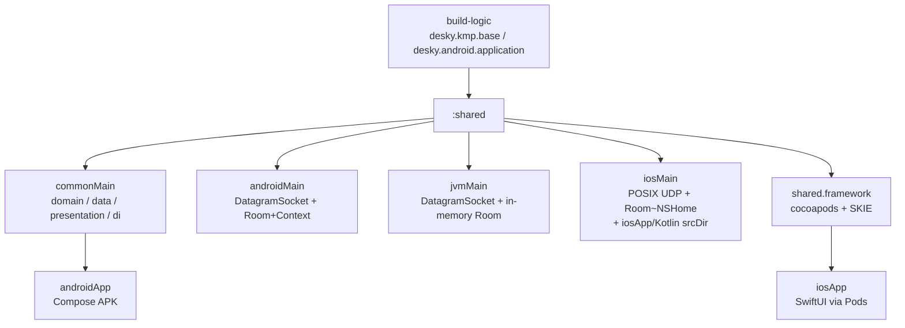
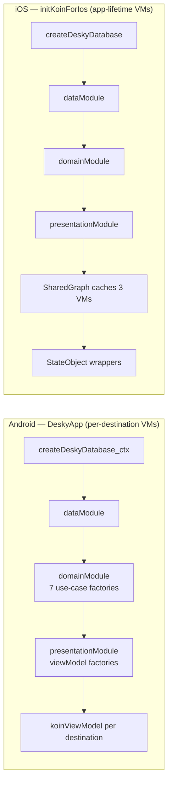
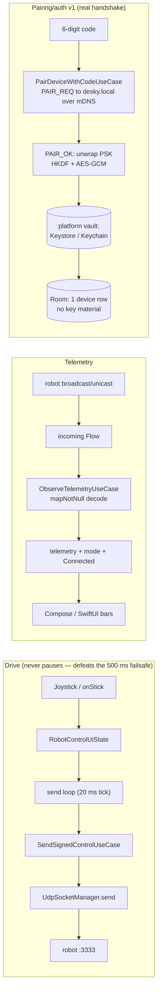

# desky-client architecture (at-a-glance)

**Mental model in one paragraph:** `:shared` is the whole app minus pixels —
protocol codec, use cases, repositories, ViewModels, DI. `androidApp` and
`iosApp` are thin native shells that render `UiState` and forward intents;
they own no business logic. The robot is a dumb UDP endpoint (6-byte control
in @ ~50 Hz, 9-byte telemetry out @ ~15 Hz, port 3333) with a ~500 ms
stale-command failsafe — the client must heartbeat, even centered. (Versions
for everything below live in `gradle/libs.versions.toml`, summarized in
`README.md`; they are not repeated here.)

## 1. Stack by concern

| Concern | What | Why it exists |
|---|---|---|
| Language/toolchain | Kotlin 2.4.20 (K2), Gradle wrapper, JDK 17, AGP | Single language for shared logic; wrapper-only, no system Gradle |
| Shared logic | Coroutines + `StateFlow`, `lifecycle-viewmodel` | UDF: one immutable `StateFlow<UiState>` per screen + intents |
| DI | Koin (`core`, `core-viewmodel`, `android`, `compose`) | Same three modules on both platforms (see §4) |
| Persistence | Room3 (`androidx.room3`) + `sqlite-bundled`, KSP per-target | Paired device + settings; in-memory builder for JVM tests |
| Networking | Raw UDP sockets (no HTTP in v1); Ktor client-core only | Sub-50 ms control loop; Ktor engines stay catalog-only (okhttp would force compileSdk 37) |
| Android UI | Compose BOM + Navigation + activity-compose | Single-activity, 3 destinations, `collectAsStateWithLifecycle()` |
| iOS bridge | `native.cocoapods` export + SKIE | Framework→Pod; SKIE turns `StateFlow` into AsyncSequence, suspend into async/await |
| iOS UI | SwiftUI, `ObservableObject` wrappers (floor is iOS 16) | Passive wrappers: snapshot + intents, one file per screen |
| Tests | `kotlin.test`, Turbine, Mokkery, coroutines-test | 84 tests in `commonTest`, run on JVM via `:shared:jvmTest` |

Dependency rule: `domain` ← nothing; `data` implements domain interfaces;
`presentation` uses use cases; UI shells depend on presentation only.

SKIE constraint (house rule — breaks the iOS build if violated): keep
`suspend` functions top-level, never members of Kotlin `object`s. SKIE
0.10.15 misgenerates the Swift wrapper for `object` suspend members
(`swiftc` fails in `linkPod*Framework*` with `static member 'shared'
cannot be used on instance of type ...`). Top-level `suspend` functions
generate correctly. Revisit on SKIE upgrade; until then the constraint
holds for all of `commonMain`. (`jvmTest` + APK builds do NOT catch this —
only `:shared:syncFramework` does, so run it for any `commonMain` API
change.)

## 2. Module & target map

| Module | Produces | Targets compiled |
|---|---|---|
| `:shared` | JVM jar, Android AAR, `iosArm64` + `iosSimulatorArm64` frameworks | android, jvm, iosArm64, iosSimulatorArm64 (no iosX64: room/sqlite lack the artifact) |
| `:androidApp` | debug/release APK (`com.desky.client`) | android (minSdk 26) |
| `iosApp` | `iosApp` scheme (`com.desky.iosapp`) | simulator arm64 / device (needs a simulator runtime to build-for-simulator) |

Quirks worth knowing (each documented at its site): `iosApp/Kotlin/IosKoin.kt`
compiles into `iosMain` via `srcDir` so `shared/src` stays frozen; Room KSP
runs per-target (no `kspCommonMainMetadata`); `pod install` regenerates
`Pods/` + `.xcworkspace` (both gitignored) from the `:shared:podspec` output.

## 3. Runtime composition (Koin graphs)

The graphs are identical; the **ownership differs, deliberately**: Koin 4
`viewModel {}` is factory-scoped, so iOS resolves each VM once and shares the
instances (per-view minting would fork state and start N heartbeat loops).
Both platforms also share the `ioScope` singleton (`SupervisorJob` +
`Dispatchers.Default`) that feeds `createUdpSocketManager(scope)`.

## 4. Data flows

Load-bearing wire details (see `README.md` protocol notes + code KDoc):
drive frames are signed `DRIVE` (counter + HMAC, PSK cached in memory,
counter persisted every 128 sends); E-STOP latches `ESTOP_FLAG` (signed
centered frame — firmware authenticates it like any drive frame); unpair
pauses the send loop and drops the cached key (loop re-reads live pairing
every tick); missing PSK surfaces "please re-pair", never legacy frames.

## 5. Build-task map

| Goal | Command (from `client/`) | Proves |
|---|---|---|
| Unit tests | `./gradlew :shared:jvmTest` | 84 `commonTest` tests on JVM |
| All shared targets | `./gradlew :shared:assemble` | JVM + Android + both iOS frameworks, Room codegen everywhere |
| Android app | `./gradlew :androidApp:assembleDebug` | APK incl. Koin/Compose wiring (compile-level) |
| iOS framework sync | `./gradlew :shared:syncFramework -Pkotlin.native.cocoapods.platform=iphonesimulator -Pkotlin.native.cocoapods.archs=arm64 -Pkotlin.native.cocoapods.configuration=Debug` | Exact Xcode-phase invocation; then `pod install` in `iosApp/` |
| iOS app | `xcodebuild -workspace iosApp.xcworkspace -scheme iosApp -configuration Debug -destination 'platform=iOS Simulator,name=iPhone 16' build` (from `iosApp/`) | Needs a simulator runtime (see README checklist) |
| CI | `client-android.yml` + `client-ios.yml` | per-platform paths filters; ubuntu: tests→APK; macOS: pod install + simulator build |

Local pure-Swift iterations can skip the Kotlin rebuild entirely (biggest
local win — the 5-file app compiles in seconds, the framework takes
minutes): set `COCOAPODS_SKIP_KOTLIN_BUILD=YES` in the Xcode scheme's Run
environment (or prefix `xcodebuild`), and **unset + rebuild after any
`shared/` or `iosApp/Kotlin/` change** — otherwise Xcode silently links a
stale framework. Never set it in CI.

## 6. Where to look next

- Wire truth: `shared/protocol/README.md` → `embedded/.../udp_codec.h` → `domain/Codec.kt` (+`Models.kt`).
- Byte order: `data/Ipv4.kt` KDoc first. Socket contract: `domain/UdpSocketManager.kt` + platform actuals.
- State machines: `presentation/RobotControlViewModel.kt` (heartbeat/estop/unpair), `PairingViewModel.kt`, `SettingsViewModel.kt`.
- Wiring: `di/AppModules.kt`, Android `DeskyApp.kt` + `ui/DeskyNavHost.kt`, iOS `Kotlin/IosKoin.kt` + `DeskyApp.swift`.
- UI pattern: stateful `XScreen` + stateless `XContent` + `@Preview` (Android); `ObservableObject` wrapper + `.task { for await }` (iOS).
